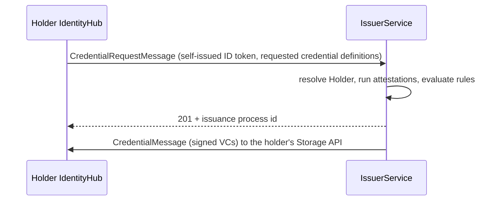
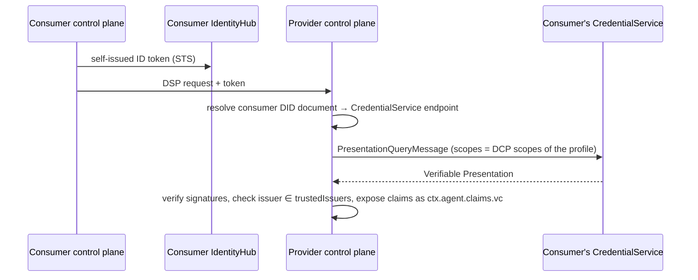

<!-- TOC -->
* [Dataspace profiles](#dataspace-profiles)
* [Identity: did:web and IdentityHub](#identity-didweb-and-identityhub)
* [Credentials: DCP issuance and the IssuerService](#credentials-dcp-issuance-and-the-issuerservice)
* [Trust at runtime: DCP presentation](#trust-at-runtime-dcp-presentation)
* [From credentials to decisions: CEL expressions](#from-credentials-to-decisions-cel-expressions)
* [Moving data: DPS and Siglet](#moving-data-dps-and-siglet)
* [Multi-tenancy: participant contexts](#multi-tenancy-participant-contexts)
* [Onboarding orchestration: CFM](#onboarding-orchestration-cfm)
* [The Core Platform Distribution](#the-core-platform-distribution)
* [Related](#related)
<!-- TOC -->

## Dataspace profiles

Every dataspace makes a few decisions that every connector in it must implement in the same way. A **dataspace
profile** packages those decisions so that an EDC runtime can apply them:

| Concern | Example (Aurora) | Where it lives in EDC |
|---------|------------------|-----------------------|
| Protocol version and binding | DSP `2025-1` over HTTPS | `DataspaceProfile.protocol` |
| JSON-LD vocabulary | DSP context, Aurora policy terms | `DataspaceProfile.jsonLdContextsUrl`, cached documents |
| Who may issue credentials | `did:web:issuer.cpd.localhost:issuer` | `DataspaceProfile.trustedIssuers` |
| Which credentials to request from a counterparty | Membership and DataProcessor credentials | DCP scopes |
| What policy terms mean | `Membership`, `DataAccess.level` | CEL expressions |

In the EDC virtual runtime a single control plane can serve **several** profiles at once. Each participant context
is associated with the profiles it takes part in. The control plane exposes DSP per participant *and* per profile:

```
POST /api/dsp/{participantContextId}/{profileName}/catalog/request
```

A real-world example is the [Catena-X profile](../../neptune.md) in this repository. This tutorial builds a much
smaller one from scratch.

## Identity: did:web and IdentityHub

Every participant is identified by a **DID**. Aurora uses `did:web`, so a DID maps to an HTTPS (here HTTP) URL that
serves its DID document:

```
did:web:identity.cpd.localhost:aurora-provider  ->  http://identity.cpd.localhost/aurora-provider/did.json
```

**IdentityHub** holds everything that belongs to a participant's identity:
- the DID document, with its verification methods and service endpoints (`CredentialService`, `ProtocolEndpoint`);
- the key pairs, whose private keys stay in Vault;
- the credentials the participant has received.

A single IdentityHub serves many participants, and each one is its own *participant context*.

## Credentials: DCP issuance and the IssuerService

The [Decentralized Claims Protocol (DCP)](https://eclipse-dataspace-dcp.github.io/decentralized-claims-protocol/)
defines two flows. The first one is **issuance**:



The **IssuerService** is configured with three kinds of objects:
- **Holders:** who is allowed to request credentials.
- **Attestation definitions:** where the claims come from, such as the holder's registration properties or a
  database table.
- **Credential definitions:** which credential type to issue, which attestations feed it, how attestation outputs
  map to `credentialSubject` fields, the format and the validity.

## Trust at runtime: DCP presentation

The second DCP flow, **presentation**, happens on every DSP request between connectors:



The *scopes* that the provider puts in its query, such as
`org.eclipse.dspace.dcp.vc.type:MembershipCredential:read`, are configured per profile as **DCP scopes**. On the
holder side, IdentityHub maps each scope to a credential query.

## From credentials to decisions: CEL expressions

EDC policies are ODRL. A constraint such as

```json
{ "leftOperand": "https://w3id.org/aurora/policy/Membership", "operator": "eq", "rightOperand": "active" }
```

means nothing to the policy engine until something defines how to evaluate it. In EDC-V that definition is a
**CEL expression** bound to the left operand. It is created at runtime through the Management API, so no Java
extension is needed:

```
ctx.agent.claims.vc.withType('MembershipCredential').hasClaim('memberOf', 'Aurora')
```

The expression receives:
- the counterparty's verified credentials (`ctx.agent.claims.vc`);
- the constraint itself (`this.rightOperand`, `this.operator`);
- depending on the policy scope, the agreement or the asset.

See [CEL Policy Expressions](https://eclipse-edc.github.io/documentation/for-adopters/control-plane/policy-engine/cel/).

## Moving data: DPS and Siglet

The control plane never touches the data itself. It *signals* a data plane over the
[Data Plane Signaling (DPS)](https://github.com/eclipse-dataplane-core) protocol.

**Siglet** is a lightweight, multi-tenant DPS data plane for *pull* transfers:
- On the **provider** side, each participant registers *transfer-type mappings* in Siglet. For example,
  `HttpData-PULL` maps to the backend at `http://cpd.localhost/api/docshare`. When a transfer starts, Siglet mints a
  short-lived access token for that transfer.
- On the **consumer** side, Siglet receives the endpoint and the token. The consumer application fetches them with
  `GET /tokens/{participantContextId}/{transferId}` and calls the provider's backend directly.
- The **backend** validates the token against Siglet's JWKS. Siglet never proxies the data.

The asset therefore carries **no** `dataAddress`. Where the data lives is a property of the provider's data plane
configuration, not of each asset.

## Multi-tenancy: participant contexts

Every EDC-V component (control plane, IdentityHub, IssuerService, Siglet) is multi-tenant. A
**participant context** is one organization's slice of a component, with its own:
- configuration, such as `edc.participant.id` and its Vault folder;
- secrets;
- assets, policies, negotiations and keys.

API paths carry the participant context id, for example `/v5/participants/{participantContextId}/assets`.

Authorization is centralized:
- **jwtlet** exchanges a workload's Kubernetes ServiceAccount token for an access token bound to one participant
  context (RFC 8693, `resource=<participantContextId>`).
- **clearglass** enforces the required scopes on every route at the gateway.

## Onboarding orchestration: CFM

The **Connector Fabric Manager** automates participant onboarding:

- **Tenant Manager (TM):** stores *tenants*, *participant profiles* (one DID plus the dataspace profiles it joins),
  *cells* (deployment zones) and *CFM dataspace profiles* (the credentials a participant must obtain). Deploying a
  participant profile triggers an orchestration.
- **Provision Manager (PM):** runs the orchestration as a DAG of *activities*. Each activity is handled by an agent.
- **Agents:** each one owns one integration.

| Agent | What it does during onboarding |
|-------|-------------------------------|
| `jwtlet-agent` | Generates the participant context id; creates jwtlet mappings so agents and workloads can act for it |
| `ih-agent` | Creates the IdentityHub participant context, DID document and key pair |
| `edcv-agent` | Creates the control plane participant context and config; associates the dataspace profiles |
| `registration-agent` | Registers the participant as a holder at the IssuerService |
| `onboarding-agent` | Sends the DCP credential request and waits until the credentials are `ISSUED` |
| `siglet-agent` | Writes the transfer-type mappings to Siglet; registers Siglet as the participant's data plane |
| `keymanagement` (lifecycle) | Reacts to key-pair events and publishes the keys to Siglet and the control plane |

Chapter [07](../07-onboarding-manual) replays every one of these steps by hand.

## The Core Platform Distribution

**CPD** is a Helm chart that installs the whole stack into one namespace (`edc-v`):
- the control plane, IdentityHub, IssuerService and Siglet;
- jwtlet and clearglass;
- the TM, the PM and the CFM agents;
- Postgres, Vault (dev mode) and NATS;
- a Traefik Gateway (`edcv-gateway`) with the routes listed in chapter [03](../03-platform).

It also seeds the platform:
- the issuer participant context (`issuer`);
- one active cell;
- the CFM orchestration definitions;
- the jwtlet scope and ServiceAccount mappings.

CPD deliberately contains **no dataspace**. There is no profile, no credentials and no CEL. Adding one is what the
rest of this tutorial does.

## Related

- [Dataspace Profiles](https://eclipse-edc.github.io/documentation/for-adopters/control-plane/dataspace-profiles/)
- [Identity Hub](https://eclipse-edc.github.io/documentation/for-adopters/identity-hub/)
- [Issuer Service](https://eclipse-edc.github.io/documentation/for-adopters/issuer-service/)
- [CEL Policy Expressions](https://eclipse-edc.github.io/documentation/for-adopters/control-plane/policy-engine/cel/)
- [Data plane migration to DPS](https://eclipse-edc.github.io/blog/2026/05/19/data-plane-migration/)
- [Connector Fabric Manager architecture](https://github.com/eclipse-cfm/cfm/blob/main/docs/developer/architecture/system.architecture.md)
