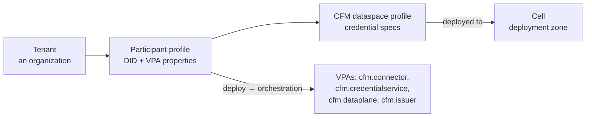
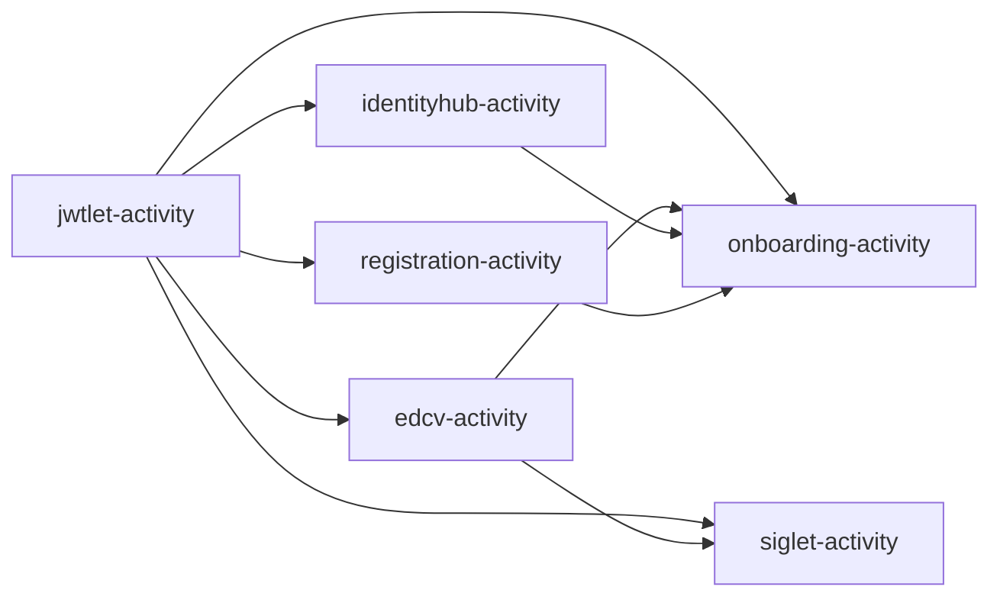

<!-- TOC -->
* [The CFM model](#the-cfm-model)
* [Step 1: a CFM dataspace profile and its deployment](#step-1-a-cfm-dataspace-profile-and-its-deployment)
* [Step 2: a tenant per organization](#step-2-a-tenant-per-organization)
* [Step 3: deploy the participant profile](#step-3-deploy-the-participant-profile)
* [Step 4: wait for the orchestration](#step-4-wait-for-the-orchestration)
* [What just happened](#what-just-happened)
* [Offboarding](#offboarding)
* [Putting it together](#putting-it-together)
* [Related](#related)
<!-- TOC -->

Script: [`04-onboard-cfm.sh`](../assets/scripts/04-onboard-cfm.sh). Payloads:
[`payloads/cfm/`](../assets/payloads/cfm).

All calls go to the Tenant Manager at `http://cpd.localhost/api/tm/...`, which maps to `/api/v1alpha1`. They need a
token with `cfm-read cfm-write`, which jwtlet expands to `tenant-manager-api:read/write`.

## The CFM model



- **Cell:** a homogeneous deployment zone, for example one CPD installation. CPD seeds one.
- **CFM dataspace profile:** what a participant of the dataspace needs, above all the **credentials**. It is the CFM
  counterpart of the EDC `DataspaceProfile` from chapter 05, which describes protocol and trust *inside the
  connector*.
- **Tenant:** a customer organization.
- **Participant profile:** one dataspace identity (DID) of a tenant. Deploying it creates four **VPAs** (Virtual
  Participant Agents), one for each piece of infrastructure the participant gets. It also starts the
  `cfm.orchestration.vpa.deploy` orchestration in the Provision Manager.

## Step 1: a CFM dataspace profile and its deployment

[`cfm/dataspace-profile.json`](../assets/payloads/cfm/dataspace-profile.json):

```json
{
  "artifacts": [],
  "properties": { "name": "aurora-2025" },
  "dataspaceSpec": {
    "protocolStack": ["dsp-2025-1", "dcp-2025-1"],
    "credentialSpecs": [
      { "id": "aurora-membership-def",    "type": "MembershipCredential",    "issuer": "did:web:issuer.cpd.localhost:issuer", "format": "VC1_0_JWT" },
      { "id": "aurora-dataprocessor-def", "type": "DataProcessorCredential", "issuer": "did:web:issuer.cpd.localhost:issuer", "format": "VC1_0_JWT" }
    ]
  }
}
```

```bash
GET  /api/tm/cells                                   # pick the active cell CPD seeded
POST /api/tm/dataspace-profiles                      # -> { "id": "<dataspaceProfileId>", ... }
POST /api/tm/dataspace-profiles/<id>/deployments     # { "profileId": "<id>", "cellId": "<cellId>" }
```

- **`credentialSpecs[].id` must equal the IssuerService credential definition id** from chapter 04. It is exactly
  what the onboarding agent puts into the DCP credential request.
- A credential spec can carry a **`role`**, for example `"role": "processor"`. It is then requested only for
  participants that have that role in `participantRoles` (step 3). This is how a dataspace gives different
  participants different credentials.
- The onboarding agent currently supports **one issuer** per orchestration.
- **Deploy the profile to the cell before you onboard anyone.** CFM places a participant in an active cell that has
  an active deployment of one of its profiles. Without one, deployment fails with `no active cell found`.

## Step 2: a tenant per organization

```bash
POST /api/tm/tenants        # { "properties": { "name": "Aurora provider", "location": "eu" } }
```

## Step 3: deploy the participant profile

[`cfm/participant-profile.json`](../assets/payloads/cfm/participant-profile.json), shown here rendered for the
consumer:

```json
{
  "identifier": "did:web:identity.cpd.localhost:aurora-consumer",
  "cellId": "<cellId>",
  "dataspaceProfileIds": ["<dataspaceProfileId>"],
  "participantRoles": { "<dataspaceProfileId>": ["member"] },
  "vpaProperties": {
    "cfm.issuer":    { "id": "did:web:identity.cpd.localhost:aurora-consumer", "memberOf": "Aurora", "level": "processing" },
    "cfm.connector": { "dataspaceProfiles": ["aurora-2025"] },
    "cfm.dataplane": {
      "authorization": { "type": "oauth2_token_exchange" },
      "transferTypeMappings": {
        "HttpData-PULL": {
          "transferType": "HttpData-PULL",
          "endpointType": "https://w3id.org/idsa/v4.1/HTTP",
          "endpoint": "http://cpd.localhost/api/docshare",
          "tokenSource": "provider",
          "txRenewalSupport": false,
          "claimMappings": [
            { "from": "flow.claims.vc.withType('DataProcessorCredential').claim('level')", "to": "level" }
          ]
        }
      }
    }
  }
}
```

```bash
POST /api/tm/tenants/<tenantId>/participant-profiles
```

| VPA property block | Consumed by | Effect |
|--------------------|-------------|--------|
| `identifier` | all agents | The participant's DID. The DID document is served at `http://identity.cpd.localhost/aurora-consumer/did.json` |
| `cfm.issuer` | `registration-agent` | Becomes the **holder properties** at the issuer, and therefore the input of the holder attestation (`id`, `memberOf`, `level`) |
| `cfm.connector.dataspaceProfiles` | `edcv-agent` | Associates the control plane participant context with the EDC profile `aurora-2025` |
| `cfm.dataplane.transferTypeMappings` | `siglet-agent` | Where the participant's backend lives for each transfer type; see chapter 08 |
| `cfm.dataplane.authorization` | `siglet-agent` | How the control plane authenticates DPS signaling to Siglet (jwtlet token exchange; endpoint, issuer and JWKS default to the platform's) |

The cell is chosen by profile deployment, as described in step 1. `cellId` is currently not used to pick it.

## Step 4: wait for the orchestration

Onboarding is asynchronous. Poll the participant profile:

```bash
GET /api/tm/tenants/<tenantId>/participant-profiles/<profileId>
```

It is done when every VPA is `active` and `properties["cfm.vpa.state"]` contains the outputs of the orchestration:

```json
{
  "vpas": [
    { "type": "cfm.connector", "state": "active" },
    { "type": "cfm.credentialservice", "state": "active" },
    { "type": "cfm.dataplane", "state": "active" },
    { "type": "cfm.issuer", "state": "active" }
  ],
  "properties": {
    "cfm.vpa.state": {
      "participantContextId": "3f0c9d…",
      "holderPid": "…",
      "credentialRequest": "http://…/credentials/request/…"
    }
  }
}
```

**`participantContextId` is generated by CFM** (a UUID without dashes) and is *not* the DID. Every later
Management API call uses it, for example `/v5/participants/<participantContextId>/assets`. The script stores it in
`assets/.state/{provider,consumer}-pcid`.

If an activity fails, `error: true` and `errorDetail` explain why. The Provision Manager's orchestrations
(`POST /api/pm/orchestrations/query`) show the state of each activity.

## What just happened

The deploy orchestration ran these activities. Arrows show dependencies, and independent activities run in
parallel:



1. **jwtlet:** generates the participant context id. It maps the CFM agents (admin scopes) and the platform
   workloads (`controlplane`: `read signaling`; `identityhub`, `siglet-sa`: `read`) to it, so they can obtain tokens
   for this participant.
2. **identityhub:** creates the IdentityHub participant context with the DID, an Ed25519 key pair (private key in
   Vault under `<ctx>/identityhub`) and the service endpoints `CredentialService`, `ProtocolEndpoint` and
   `DataService` in the DID document.
3. **edcv:** creates the control plane participant context (`identity` = DID), sets its config (`edc.participant.id`,
   the Vault folder `<ctx>/controlplane`) and associates `aurora-2025`.
4. **registration:** creates the holder at the IssuerService with the `cfm.issuer` properties.
5. **siglet:** writes the transfer-type mappings to Siglet and registers `<ctx>-siglet` as the participant's data
   plane in the control plane.
6. **onboarding:** asks IdentityHub to request the profile's credentials from the issuer over DCP. It waits until
   the request is `ISSUED`.

The always-running **key-management lifecycle agent** also reacts to the new key pair and publishes it to Siglet
and to the control plane's STS configuration.

Chapter [07](../07-onboarding-manual) performs each of these steps with explicit API calls.

## Offboarding

```bash
DELETE /api/tm/tenants/<tenantId>/participant-profiles/<profileId>
```

This runs `cfm.orchestration.vpa.dispose`, which CPD defines with four activities that run in parallel:
- `onboarding` revokes the issued credentials;
- `registration` deletes the holder;
- `edcv` deletes the control plane participant context and its config;
- `siglet` removes the transfer-type mappings and the data plane registration.

## Putting it together

- [ ] CFM dataspace profile with credential specs whose ids match the issuer's credential definitions
- [ ] Profile deployed to the active cell
- [ ] One tenant and one participant profile each for provider (`level: sensitive`) and consumer (`level: processing`)
- [ ] All VPAs `active`; `cfm.vpa.state.participantContextId` recorded

## Related

- [CFM system architecture](https://github.com/eclipse-cfm/cfm/blob/main/docs/developer/architecture/system.architecture.md)
- [Orchestrator design](https://github.com/eclipse-cfm/cfm/blob/main/docs/developer/architecture/provisioning/orchestrator.design.md)
- Tenant Manager OpenAPI: `tmanager/docs/openapi.json` in the CFM repository
