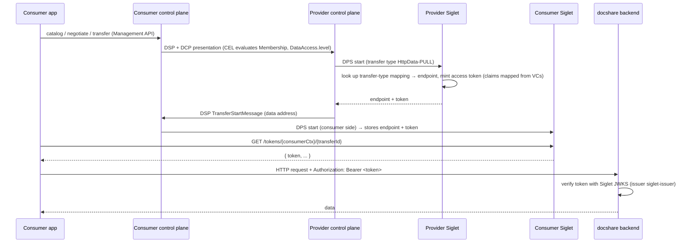

<!-- TOC -->
* [How a pull transfer works with Siglet](#how-a-pull-transfer-works-with-siglet)
* [The backend](#the-backend)
* [Pointing Siglet at the backend](#pointing-siglet-at-the-backend)
* [The provider's offer](#the-providers-offer)
* [The consumer's side](#the-consumers-side)
* [Writing your own backend](#writing-your-own-backend)
* [Putting it together](#putting-it-together)
* [Related](#related)
<!-- TOC -->

Scripts: [`05-backend.sh`](../assets/scripts/05-backend.sh), [`06-provider-offer.sh`](../assets/scripts/06-provider-offer.sh),
[`07-consumer-transfer.sh`](../assets/scripts/07-consumer-transfer.sh).

## How a pull transfer works with Siglet



The data never flows through EDC. The control planes negotiate, Siglet issues and stores the token, and the consumer
calls the backend directly.

## The backend

[`backend/docshare.yaml`](../assets/backend/docshare.yaml) deploys **docshare**, a small document store. It is the
data plane of the [JAD](https://github.com/eclipse-dataspace-hub/jad) reference deployment
(`ghcr.io/eclipse-dataspace-hub/jad/dataplane`):

| API | Port / path | Exposure | Purpose |
|-----|-------------|----------|---------|
| control | `:8083/api/control/certs` | internal (port-forward) | Provider uploads and lists documents |
| public | `:8186/api/data/certs` → `http://cpd.localhost/api/docshare/certs` | gateway | Consumer lists (`POST /certs/request`) and downloads (`GET /certs/{id}`) documents. **Requires a Siglet token** |

The token check is configured with just two settings:

```properties
edc.iam.siglet.issuer=siglet-issuer
edc.iam.siglet.jwks.url=http://siglet.edc-v.svc.cluster.local:8080/keys
```

`05-backend.sh` deploys it, uploads [`samples/aurora-quarterly-report.txt`](../assets/backend/samples) through the
control API, and shows that the public API rejects requests without a token.

> docshare is a demo. Any valid token for any of its transfers can read every document, because it has no
> per-asset authorization. A real backend uses the token's claims (below) to decide *what* a caller may see.

## Pointing Siglet at the backend

The asset does not say where the data is. The **provider's transfer-type mapping** in Siglet does. It was set
during onboarding, through `cfm.dataplane` in chapter 06 or with
[`siglet-transfer-type-mapping.json`](../assets/payloads/manual/siglet-transfer-type-mapping.json) in chapter 07:

```json
"HttpData-PULL": {
  "transferType": "HttpData-PULL",
  "endpointType": "https://w3id.org/idsa/v4.1/HTTP",
  "endpoint": "http://cpd.localhost/api/docshare",
  "tokenSource": "provider",
  "txRenewalSupport": false,
  "claimMappings": [
    { "from": "flow.claims.vc.withType('DataProcessorCredential').claim('level')", "to": "level" }
  ]
}
```

- **`endpoint`** is what the consumer receives. It must be reachable *from the consumer*, so it is the public
  gateway URL, not the in-cluster service.
- **`tokenSource: provider`** means the provider's Siglet issues the access token.
- **`claimMappings`** copy claims from the consumer's verified credentials into the access token. Here the
  backend receives `level: processing` and can filter documents by certification level without knowing anything
  about DCP. The `from` side is a CEL expression over the transfer's flow context.
- **`endpointMappings`** (not used here) replace the single `endpoint` with a list of `key`/`value` →
  `endpoint` entries, so that one transfer type can route to several backends. See the Siglet documentation for
  the matching semantics.
- **`txRenewalSupport`** enables token refresh compatible with Tractus-X connectors.

## The provider's offer

The provider publishes two assets. They differ only in the certification level their access policy requires:

| Asset | Access policy | Contract policy |
|-------|---------------|-----------------|
| `aurora-docs-processing` | `Membership eq active` AND `DataAccess.level eq processing` | `Membership eq active` |
| `aurora-docs-sensitive` | `Membership eq active` AND `DataAccess.level eq sensitive` | `Membership eq active` |

[`policy-access-processing.json`](../assets/payloads/provider/policy-access-processing.json):

```json
{
  "@context": ["https://w3id.org/edc/connector/management/v2"],
  "@type": "PolicyDefinition",
  "@id": "aurora-access-processing",
  "policy": {
    "@type": "Set",
    "permission": [{
      "action": "use",
      "constraint": [{ "and": [
        { "leftOperand": "https://w3id.org/aurora/policy/Membership",        "operator": "eq", "rightOperand": "active" },
        { "leftOperand": "https://w3id.org/aurora/policy/DataAccess.level", "operator": "eq", "rightOperand": "processing" }
      ]}]
    }]
  }
}
```

The asset itself ([`asset-processing.json`](../assets/payloads/provider/asset-processing.json)) has only properties.
Under DPS there is no `dataAddress`:

```json
{ "@context": ["https://w3id.org/edc/connector/management/v2"], "@type": "Asset",
  "@id": "aurora-docs-processing", "properties": { "name": "Aurora shared documents (processing)" } }
```

```bash
POST /api/management/v5/participants/<provider-ctx>/policydefinitions   # x3
POST /api/management/v5/participants/<provider-ctx>/assets              # x2
POST /api/management/v5/participants/<provider-ctx>/contractdefinitions # x2
```

## The consumer's side

`07-consumer-transfer.sh` runs these steps as the consumer, whose `DataProcessorCredential.level` is `processing`.

**1. Catalog.**

```bash
POST /api/management/v5/participants/<consumer-ctx>/catalog/request
{ "@type": "CatalogRequest", "protocol": "aurora-2025",
  "counterPartyAddress": "http://controlplane.edc-v.svc.cluster.local:8082/api/dsp/<provider-ctx>/aurora-2025",
  "counterPartyId": "did:web:identity.cpd.localhost:aurora-provider" }
```

The provider requests the consumer's credentials (DCP scopes), verifies them (trusted issuer) and evaluates each
contract definition's access policy (CEL). The catalog contains `aurora-docs-processing` and **not**
`aurora-docs-sensitive`. That is the credential-based policy at work, and the script asserts it.

**2. Negotiation.** The script sends the offer from the catalog back as a `ContractRequest`. The provider evaluates
the contract policy, again with CEL. The request reaches `FINALIZED` with a `contractAgreementId`.

**3. Transfer.** A `TransferRequest` with `transferType: HttpData-PULL`, which reaches `STARTED`.

**4. Token.** The consumer fetches the access token from its own Siglet:

```bash
GET http://cpd.localhost/api/siglet/tokens/<consumer-ctx>/<transferId>
# { "token": "eyJ...", ... }
```

**5. Data.**

```bash
curl -X POST http://cpd.localhost/api/docshare/certs/request -H "Authorization: Bearer $TOKEN" -H 'Content-Type: application/json' -d '{}'
curl http://cpd.localhost/api/docshare/certs/<id> -H "Authorization: Bearer $TOKEN"
```

> The `counterPartyAddress` used here is the provider's **in-cluster** DSP address, because both participants run on
> the same platform. A consumer elsewhere would use the `ProtocolEndpoint` from the provider's DID document
> (`http://cpd.localhost/api/dsp/<provider-ctx>/aurora-2025`).

## Writing your own backend

Any HTTP service can be exposed this way. It needs to:

1. **Validate the bearer token**:
   - the signature, against the JWKS at `http://siglet.edc-v.svc.cluster.local:8080/keys` (externally
     `http://cpd.localhost/api/siglet/keys`);
   - `iss` = `siglet-issuer`;
   - expiry.
2. **Authorize using the claims**:
   - `sub` identifies the consumer;
   - mapped claims such as `level` carry credential facts.
3. **Register** its public URL as the `endpoint` of the provider's transfer-type mapping.

The backend needs no EDC dependency and no knowledge of DSP, DCP or ODRL.

## Putting it together

- [ ] docshare deployed; sample document uploaded; public API rejects requests without a token
- [ ] Provider: 3 policies, 2 assets, 2 contract definitions
- [ ] Consumer: sees `aurora-docs-processing` only; negotiation `FINALIZED`; transfer `STARTED`
- [ ] Consumer downloads the document with the Siglet token

## Related

- [Data plane migration to DPS](https://eclipse-edc.github.io/blog/2026/05/19/data-plane-migration/)
- [Siglet](https://github.com/eclipse-dataplane-core/dsdk-facet-rs/tree/main/siglet)
- [Data Plane Signaling SDKs](https://github.com/eclipse-dataplane-core)
