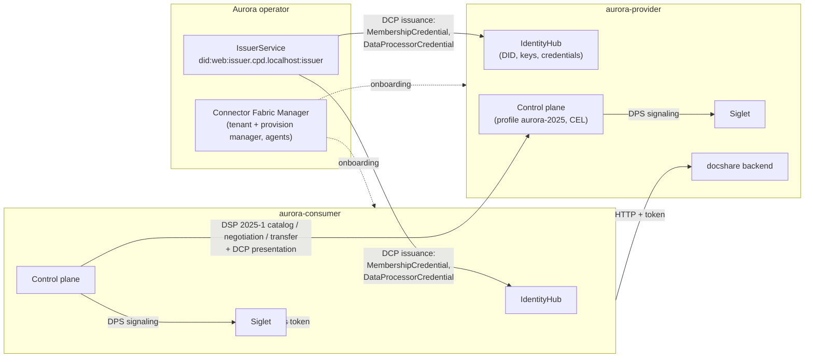

<!-- TOC -->
* [What you will build](#what-you-will-build)
* [The components](#the-components)
* [Two ways to onboard](#two-ways-to-onboard)
* [Prerequisites](#prerequisites)
* [Chapters](#chapters)
* [Just want to run it?](#just-want-to-run-it)
<!-- TOC -->

> **Status.** This tutorial targets the EDC virtual runtime (EDC-V), the Connector Fabric Manager (CFM) and the Core
> Platform Distribution (CPD). Several of the APIs it uses, such as dataspace profiles, CEL expressions and the CFM
> `v1alpha1` APIs, are still **experimental** and may change.

A *dataspace* is a set of organizations that agree on how to trust each other and how to exchange data. Running
connectors is only part of the work. Someone also has to decide:

- which protocol versions the dataspace speaks;
- which verifiable credentials prove membership, and who issues them;
- how a connector turns those credentials into policy decisions;
- how a new organization obtains its identity, its credentials and its connector.

This tutorial walks through all of these decisions for a small fictional dataspace called **Aurora**. It then
implements them with EDC components. Every step has a matching script and payload under [`assets/`](./assets), so you
can read each chapter, run its script and inspect the result.

## What you will build



By the end you will have:

- **A dataspace profile, `aurora-2025`.** It specifies the protocol (DSP 2025-1), the trusted issuer, two DCP
  scopes and two CEL expressions that turn credentials into policy decisions.
- **An issuer** that issues a `MembershipCredential` and a `DataProcessorCredential` (with an access `level`) to
  every participant it onboards.
- **Two participants, `aurora-provider` and `aurora-consumer`.** Each has a `did:web` identity, a key pair, its
  credentials, a control plane participant context and a Siglet data plane.
- **A backend application, `docshare`,** exposed by the provider. The consumer can reach it only after negotiating a
  contract. The provider offers two assets, and the consumer only *sees* the one its credentials qualify for.

Everything runs as **one** multi-tenant platform (CPD) on a local KinD cluster. Both participants are virtual
participants, i.e. participant contexts, inside the same EDC-V runtimes. That is how a dataspace operator or a
service provider would host many organizations.

## The components

| Component | Role in the dataspace | Chapter |
|-----------|-----------------------|---------|
| **EDC-V control plane** | DSP protocol endpoints, Management API, policy engine (CEL), per-participant contexts | 05, 08 |
| **IdentityHub** | Per-participant DIDs, keys and credential storage; answers DCP presentation queries | 06, 07 |
| **IssuerService** | Issues the dataspace's verifiable credentials over DCP | 04 |
| **Siglet** | DPS data plane: hands out access tokens and maps transfer types to backend endpoints | 08 |
| **jwtlet / clearglass** | Platform token exchange (RFC 8693) and API gateway authorization | 03, 07 |
| **CFM** (tenant manager, provision manager, agents) | Onboarding orchestration | 06 |
| **CPD** | Helm chart that installs all of the above plus Postgres, Vault, NATS and the gateway | 03 |

Chapter [01](./01-concepts) explains how these components fit together.

## Two ways to onboard

Onboarding a participant means creating:
- a participant context in IdentityHub (DID document and key pair);
- a participant context in the control plane, associated with the profile;
- a holder at the issuer;
- a DCP credential request;
- a Siglet data plane registration.

You can do this in two ways:

- **With CFM (chapter [06](./06-onboarding-cfm)).** You describe the participant once, in a *participant profile*,
  and CFM's agents perform every step. This is the recommended way to run a dataspace.
- **Manually (chapter [07](./07-onboarding-manual)).** You make each API call yourself. Use it to understand what
  CFM does, to debug, or to integrate EDC into an orchestration tool of your own.

Both paths produce the same result, so chapters 08 and 09 work after either one.

## Prerequisites

- Docker, [`kind`](https://kind.sigs.k8s.io/), `kubectl`, `helm` (3.8+), `curl`, `jq` and `envsubst` (from GNU
  gettext).
- About 8 GB of RAM for the cluster.
- Ports 80 and 443 free on your machine. The gateway listens on `http://cpd.localhost`, and `*.localhost` resolves
  to loopback on most systems. If it doesn't on yours, add `127.0.0.1 cpd.localhost identity.cpd.localhost
  issuer.cpd.localhost` to `/etc/hosts`.
- Familiarity with EDC concepts (assets, policies, contract definitions) helps. The
  [Adopters Manual](https://eclipse-edc.github.io/documentation/for-adopters/) is a good companion.

## Chapters

1. [Concepts](./01-concepts): dataspace profiles, DCP, IdentityHub, IssuerService, CEL, Siglet and CFM.
2. [Designing the Aurora profile](./02-design-profile): from governance decisions to identifiers, credentials,
   scopes and expressions.
3. [The platform](./03-platform): KinD, the gateway, CPD, did:web DNS and API tokens.
4. [Preparing the issuer](./04-issuer): attestation and credential definitions.
5. [Configuring the connector](./05-connector-profile): profile, trusted issuers, DCP scopes and CEL expressions.
6. [Onboarding with CFM](./06-onboarding-cfm)
7. [Onboarding manually](./07-onboarding-manual)
8. [Sharing a backend through Siglet](./08-siglet-backend): offers, negotiation, transfer and the access token.
9. [Try it, troubleshoot, adapt it](./09-try-it)

## Just want to run it?

```bash
cd tutorial/assets/scripts
./run-all.sh --mode cfm        # or: --mode manual (on a fresh cluster)
```

See chapter [09](./09-try-it) for details.
